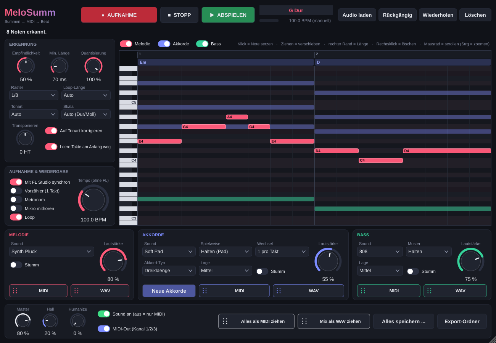

# MeloSumm – Summen → MIDI → Beat

VST3-Plugin für FL Studio (Windows). Du summst, singst oder pfeifst eine Melodie, MeloSumm erkennt die Töne, macht daraus MIDI und baut passende **Akkorde** und einen **Bass** dazu. Alles klingt direkt über eingebaute Sounds, oder du nimmst nur das MIDI.

---

## 1. Die .vst3-Datei bekommen (einmalig, ca. 10 Minuten)

GitHub baut das Plugin kostenlos für dich. Du brauchst **keine Ordner** hochzuladen.

**Schritt A: Repository anlegen**
1. Auf **github.com** ein kostenloses Konto anlegen und einloggen.
2. Oben rechts auf **+** → **New repository** klicken. Name: `MeloSumm`. Auf **Private** stellen und **Create repository** klicken.

**Schritt B: Dateien hochladen**
3. Auf der neuen Seite den Link **„uploading an existing file"** anklicken.
4. Die ZIP entpacken. Dann im Ordner `MeloSumm` **alle Dateien markieren** (Strg+A) und ins Browserfenster ziehen. Alternativ „choose your files" klicken und alle Dateien auswählen.
5. Unten auf **Commit changes** klicken.

**Schritt C: Bau-Auftrag anlegen**
6. Im Repository auf **Add file** → **Create new file** klicken.
7. Als Dateinamen genau `.github/workflows/build.yml` eintippen. Jeder `/` erzeugt automatisch einen Ordner, das ist richtig so.
8. Die Datei `build.yml` aus der ZIP mit dem Editor öffnen, den **ganzen Inhalt kopieren** und in das große Textfeld einfügen.
9. Auf **Commit changes…** klicken und noch einmal bestätigen.

**Schritt D: Plugin herunterladen**
10. Oben auf den Reiter **Actions** gehen. Dort läuft jetzt **„MeloSumm bauen"**.
11. Etwa 8–15 Minuten warten, bis ein grüner Haken erscheint. Den Lauf anklicken und unten bei **Artifacts** auf **MeloSumm-Windows** klicken.

## 2. In FL Studio installieren

1. Die heruntergeladene ZIP entpacken. Darin liegt der Ordner **`MeloSumm.vst3`**.
2. Diesen Ordner nach `C:\Program Files\Common Files\VST3\` kopieren.
3. FL Studio öffnen → **Options → Manage plugins → Find installed plugins** klicken.
4. Bei **MeloSumm** den Stern setzen (Favorit). Dann taucht das Plugin in der Plugin-Liste auf.

Zusätzlich liegt `MeloSumm.exe` bei. Das ist eine eigenständige Version zum Ausprobieren ohne FL Studio. Dort unter **Options → Audio settings** dein Mikro wählen und **„Mute audio input"** ausschalten.

## 3. Benutzen

### Mikro einrichten
1. Im **Mixer** einen freien Insert-Kanal wählen.
2. Oben rechts im Mixer bei **Input** dein Mikrofon auswählen.
3. In einen Effekt-Slot dieses Kanals **MeloSumm** laden.

### Melodie aufnehmen
- **AUFNAHME** drücken. Ohne laufendes FL kommt ein Vorzähler (4 Klicks), dann summst du. Mit Metronom ist das Timing am besten.
- Läuft FL Studio gerade (Play), startet die Aufnahme automatisch am **nächsten Takt** und läuft im FL-Tempo.
- Nochmal **AUFNAHME** (oder STOPP) drücken: MeloSumm analysiert die Aufnahme. Melodie, Akkorde und Bass erscheinen im Piano Roll.
- Alternativ: **Audio laden** oder eine WAV/MP3 einfach aufs Plugin ziehen.

**Tipps für gute Erkennung:** Deutlich summen, z. B. „da-da-da" oder „na-na". Jede neue Note kurz neu ansetzen. Nah am Mikro, Kopfhörer tragen.

### Bearbeiten (jede Melodie ist möglich)
- **Klick** ins Raster = neue Note · **Ziehen** = verschieben · **rechter Rand** = Länge ändern · **Rechtsklick** = löschen
- **Mausrad** = hoch/runter scrollen, **Strg + Mausrad** = zoomen
- **Strg+Z / Strg+Y** = rückgängig / wiederholen
- Du kannst auch ganz ohne Aufnahme einfach Noten zeichnen. Die Begleitung entsteht automatisch.

### Einstellungen
| Bereich | Was es macht |
|---|---|
| Empfindlichkeit | Höher = auch leise/wacklige Töne werden erkannt |
| Min. Länge | Kürzere Noten (Wackler) fliegen raus |
| Raster / Quantisierung | Auf welches Notenraster das Timing gezogen wird, und wie stark |
| Auf Tonart korrigieren | Schiefe Töne werden auf die Tonleiter gezogen |
| Tonart / Skala | Auto oder fest (Dur, Moll, Harmonisch Moll, Dorisch, Phrygisch, Pentatonik, Blues …) |
| Transponieren | Alles in eine andere Tonhöhe verschieben |
| Loop-Länge | Auto oder 1–32 Takte |
| Akkorde: Spielweise | Pad, Stabs, Achtel-Pulse, 3 Arpeggios, Piano gebrochen, Offbeat |
| Akkorde: Typ / Wechsel / Lage | Dreiklänge, Septakkorde, add9, 9er · 2 pro Takt bis alle 2 Takte · tief/mittel/hoch |
| Neue Akkorde | Würfelt eine andere passende Akkordfolge |
| Bass: Muster | Halten, Halbe, Viertel, Achtel, Oktaven, Synkopiert, 808 Trap, Walking |
| Sounds | 21 eingebaute Instrumente: Pluck, Piano, E-Piano, Gitarre, Harfe, Glocke, Marimba, Leads, Supersaw, Pads, Strings, Choir, Orgel, Flöte, Sub, 808, Reese … |
| Humanize | Macht Akkorde/Bass etwas lebendiger (Timing und Anschlag) |

### In FL Studio übernehmen
- **MIDI**-Knöpfe (pro Spur oder „Alles als MIDI ziehen") **direkt ins Piano Roll, in die Playlist oder auf einen Channel** ziehen. Dann kannst du jedes eigene Instrument (Serum, FLEX, Vital …) benutzen.
- **WAV**-Knöpfe ziehen den Sound als fertiges Sample (nahtlose Loop, mit Hall) in die Playlist.
- **Alles speichern …** legt MIDI und WAV (komplett und jede Spur einzeln) in einen Ordner.
- Alle gezogenen Dateien liegen außerdem in `Dokumente\MeloSumm Exporte`.

### Nur MIDI
- **„Sound an"** ausschalten. Dann gibt das Plugin keinen Ton aus, nur MIDI.
- **MIDI-Out** (für Fortgeschrittene): MeloSumm sendet live Melodie auf Kanal 1, Akkorde auf Kanal 2 und Bass auf Kanal 3. In FL im Plugin-Fenster über das Zahnrad bei **MIDI → Output port** eine Portnummer einstellen und beim Ziel-Instrument denselben Port als **Input port** wählen.

---

## Für Entwickler
- C++17, JUCE 8 (wird beim Bauen automatisch geladen), CMake. Alle Quelltexte liegen flach in einem Ordner.
- Lokal bauen: `cmake -B build -A x64` und danach `cmake --build build --config Release`.
